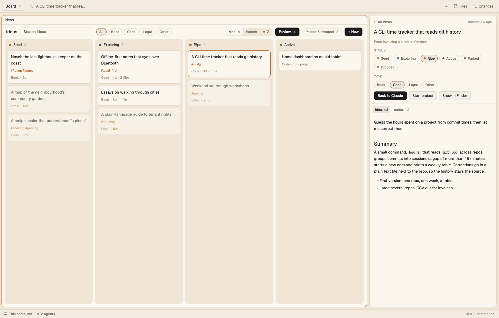
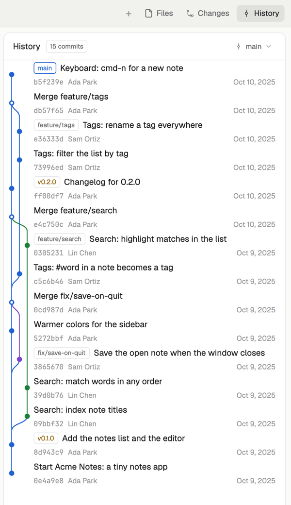
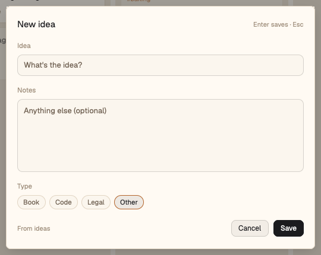
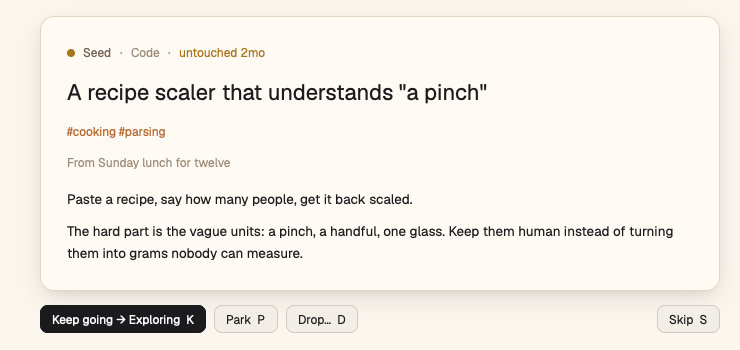

# Herdr profiles

**One window per kind of project.** A book wants a quiet, warm page; an idea
inbox wants a board; a repo wants its history at hand. Profiles give
[Herdr](https://herdr.dev) a layout, a theme and panels for each kind of
project, and switch to the right one as you move between spaces.

[](https://github.com/jmorenobl/herdr-profiles/actions/workflows/test.yml)
[](LICENSE)
[](https://herdr.dev)


<p align="center"></p>

## How it feels

- **Go to a space, get its window.** An invisible switcher in every profile
  picks the profile from the space's folder: a `.herdr-profile` file, a
  rule of yours, or the default. No buttons, no setup per project.
- **Panels that know the project.** Files shows markdown rendered, with
  images and links. History shows the repo's commits and branches as a
  graph, with each commit's diff one click away.
- **Your Herdr stays yours.** Install only adds: your layouts, themes, keys
  and rules are never changed, and uninstall takes back what it added
  (unless you changed it since).

## The profiles

### `standard`: every project, by default

Herdr's main window, plus a **Files** panel that renders markdown (images,
badges, links between files) and a **History** panel: commits and branches
as a graph, tags and branch chips, a branch picker, and each commit's files
and diffs. Read-only: it never writes to your repo.

<p align="center"></p>

### [`ideas`](profiles/ideas/README.md): an idea inbox

A warm theme and a kanban of ideas by status: seed, exploring, ripe,
active (and parked or dropped, out of the way). Each
idea is a folder with its notes; open it, develop it with your coding
agent, or start a project from it.

- **Quick capture** from any space with `ctrl-shift-i`.
- **A weekly review** walks you through the ideas nobody touched in a month:
  keep going, park or drop, one key each.
- **Autocommit**: when the folder is a git repo, every change is committed
  after a quiet minute, with a subject naming the idea.

<p align="center"></p>

<p align="center"></p>

More in [the ideas profile's README](profiles/ideas/README.md).

## Install

```sh
git clone https://github.com/jmorenobl/herdr-profiles.git herdr-profiles
cd herdr-profiles
make install                # every profile; or: make install ARGS="ideas"
```

`make install ARGS="ideas"` installs the core (`standard` and the switcher,
always installed) and `ideas`; `ARGS="standard"` installs only the core.
Keep the clone: you update and uninstall from it.

The first time, a profile may ask a question, like where your ideas live:

```
  ideas: Where do your ideas live? [~/ideas]
```

Enter takes the default in brackets. A folder must start with `/` or `~/`
and can't be your home folder or above it (a rule there would match every
project); an answer that won't do is explained and asked again. Without a
terminal (a script, output piped) the default is used and said; answer in
advance with `make install ARGS="--set ideas.folder=~/notes/ideas"` (a
value with spaces: `ARGS='--set "ideas.folder=~/my ideas"'`).

Then, in Herdr, switch to the `standard` layout once: Settings, or
`herdr-app do layout.switch '{"name":"standard"}'`. From then on the window
follows the space you go to. The switcher lives in the profiles' layouts, so
on a layout of your own (or Herdr's `main`) nothing switches until you come
back to a profile's layout.

### Requirements

- [Herdr app](https://herdr.dev) 0.1.14 or newer. Install checks
  `herdr-app --version` first; if `herdr-app` isn't on your `PATH`, set
  `HERDR_APP_BIN` to it (`ARGS="--skip-version-check"` installs anyway).
- Python 3.9 or newer (standard library only), `make` and `git`. The ideas
  profile uses `git` to commit your ideas folder (when it's a git repo).
- **macOS only**, for now. The profiles haven't been tried in Herdr on
  Linux, so it isn't supported yet (the ideas panel already uses
  `xdg-open` there, and the tool's tests run on Ubuntu in CI).

## Which project gets which profile

That's yours, in `~/.config/herdr-app/profiles.json`. Install creates it
the first time and adds each new profile's entry and suggested rules once:

```json
{
  "default": "standard",
  "profiles": {
    "standard": { "layout": "standard" },
    "ideas": { "layout": "ideas", "folder": "~/ideas" }
  },
  "rules": [
    { "path": "~/ideas", "profile": "ideas" }
  ]
}
```

When you go to a space, the switcher looks at its folder (its first
terminal's), and picks:

1. the profile named in a `.herdr-profile` file in that folder or a parent
   (to pin one project, put the profile's name in one at its root);
2. else the first rule that matches: `path` (the folder is inside it) and/or
   `has` (a file or folder with that name is in the project or a parent),
   e.g. `{ "has": ".board.json", "profile": "ideas" }`;
3. else `default`.

Rules compare folders as text, so:

- **Letter case counts**, even though macOS folders don't: `~/Code` doesn't
  match a space in `~/code`.
- **Symlinks aren't followed**: the folder is the one the terminal reports.
  If you reach a project through a symlink, write the rule for that path (or
  add a rule for each).
- **`~` in `path` is this computer's home**, and isn't read at all for a
  space on another machine: there, write the full folder
  (`/home/you/ideas`). `.herdr-profile` files and `has` work there as here.

Edits apply the next time you change space. A profile's own settings (like
the ideas folder, or its [other options](profiles/ideas/README.md)) go in
its entry; install never asks again once a profile is there: change it in
the file.

## What install changes in your Herdr, and what not

- **It adds** the profiles' layouts (`layouts/standard.json`,
  `layouts/ideas.json`), their themes and mods (`mods/profiles`,
  `mods/standard-*`, `mods/ideas`), and a record of what it wrote
  (`.herdr-profiles.json`), all in `~/.config/herdr-app`.
- **Your own layouts, themes and mods are never touched.** If one has a
  name a profile uses (`mods/ideas/`, `themes/ideas.json`, …), install stops
  before writing anything, says which, and suggests moving yours or
  installing without that profile.
- **`standard` becomes the default profile** (only if `profiles.json` has
  no `"default"` yet): the window for every space no rule picks. To change
  it, set `"default"` to another profile in `profiles.json`.
- **Keys are only added where free.** `ctrl-shift-i` (ideas' quick capture)
  goes into `keys.json` only if you don't use it; otherwise install says so
  and leaves yours. With no `keys.json` at all, install adds nothing and
  says what to add. Adding a key is a small edit to `keys.json` (one line
  more, in your file's own indentation; the rest stays as you wrote it),
  and Herdr then treats the file as yours: it no longer adds new default
  shortcuts to it on upgrades, even after an uninstall.
- **`profiles.json` is only added to**: a new profile's entry (if it isn't
  there), its suggested rules (if not there), and the default (if none).
  Nothing in it is ever changed or removed by install, and its formatting
  stays.
- A file install wrote that you then edited in Herdr isn't overwritten: the
  next install stops and says which. `ARGS="--force"` overwrites it with
  the repo's; to keep your change, copy it to a name of your own first
  (install's suggestion to `pull` is for working on this repo, see
  CONTRIBUTING.md).

## Update

```sh
git pull && make install
```

Profiles you have are updated; new profiles in the repo are added, except
those you uninstalled. `make install ARGS="standard"` updates without adding
any. `make status` shows what differs from the repo (or says it matches),
and the profiles you don't have.

Install from one clone. If another clone (or a worktree) of the repo
installed last, install stops before writing and says which; installing
from here would remove what that one has and this one doesn't.
`make install ARGS="--take-over"` makes this clone the one that installs.

## Uninstall

```sh
make uninstall ARGS="ideas"   # one profile
make uninstall                # everything
```

- It removes the files install wrote (that profile's, or all), except those
  you edited in Herdr: they're kept and are yours from then on (with their
  mod's `mod.json`).
- It takes back what install added to `profiles.json` (the entry, its
  rules, the default) and `keys.json` (like `ctrl-shift-i`), but only where
  they're still exactly as install left them. An entry or rule you changed,
  a key you rebound and anything you added yourself stay, and it says what
  it kept. A `profiles.json` install created is deleted by a full uninstall
  only if nothing is left in it; one you had is left as you had it (the
  `"default"`, `"profiles"` or `"rules"` install added go too, once empty).
  The `layouts/`, `themes/` and `mods/` folders install made go too, if
  nothing is left in them. (Installed before 0.9.2? Those folders stay,
  and any of `"default"`, `"profiles"`, `"rules"` left empty goes, since
  which ones install added isn't known.)
- The core (`standard`) can't be uninstalled while another profile is
  installed: uninstall that one first, or everything.
- A profile you uninstall stays uninstalled: plain `make install` leaves it
  out (and says so). `make install ARGS="ideas"` brings it back, as a first
  time again: its question, entry, rules and keys, except where what you
  changed was kept (an entry still in `profiles.json` is used as it is). A full uninstall forgets
  everything.
- Your ideas folder and anything else of yours outside the Herdr home are
  never touched.

Installed with a version before 0.8.0? It didn't record what it added to
your files. The next `make install` records what is still exactly as it
would have added it, and says so; uninstall then takes those back too. The
rest it leaves, and lists for you.

## Contributing

How it works inside, the layout recipes, adding a profile, the developer
commands (`make pull`, `make check`, `make test`) and publishing:
[CONTRIBUTING.md](CONTRIBUTING.md). Changes are listed in
[CHANGELOG.md](CHANGELOG.md).

## License

Apache License 2.0 ([LICENSE](LICENSE)), the same as Herdr. Some files are
clones of Herdr's own layout and mods, changed for these profiles, and the
icons are Lucide's: [NOTICE](NOTICE) says which, and
[LICENSES/](LICENSES/) has the icons' notice.
