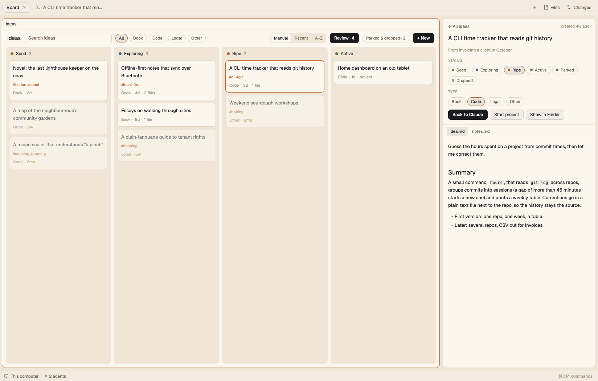
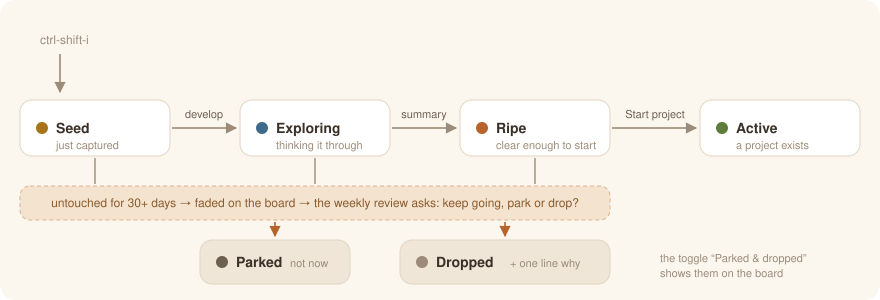
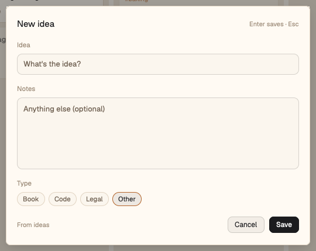
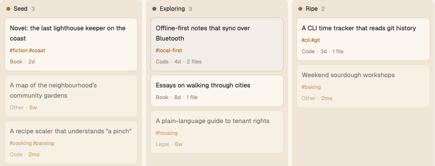
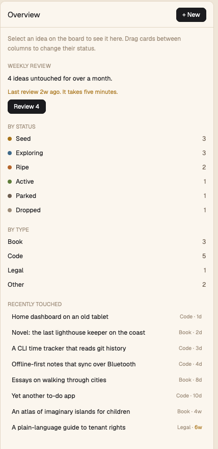
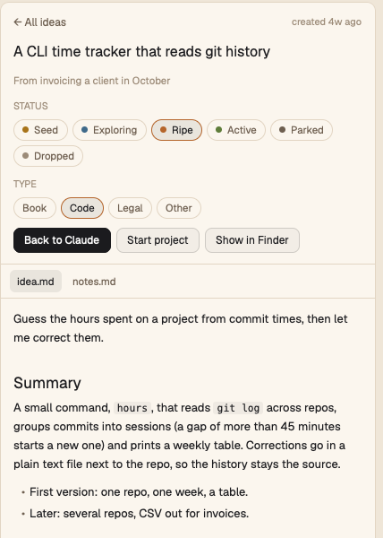
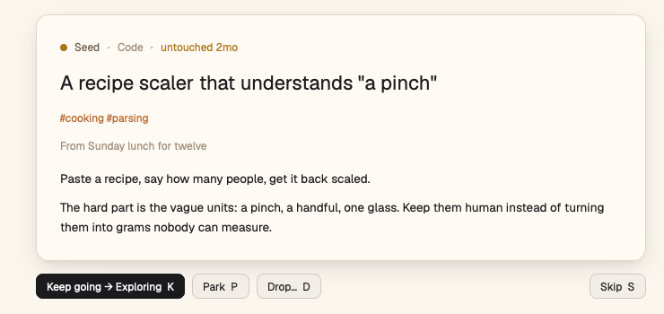

# 💡 Ideas

**An idea inbox that lives in Herdr.** Capture an idea from anywhere with one
key, watch it grow on a kanban board, develop it with Claude, turn it into a
project, and once a week spend five minutes deciding what to do with the ideas
nobody has touched in a while.



<table>
<tr>
<td width="25%" align="center"><b>⌨️ Capture</b><br><sub><code>ctrl-shift-i</code> from any space</sub></td>
<td width="25%" align="center"><b>🗂️ Board</b><br><sub>one column per status, drag to move</sub></td>
<td width="25%" align="center"><b>🤖 Develop</b><br><sub>one Claude tab per idea</sub></td>
<td width="25%" align="center"><b>🧹 Review</b><br><sub>stale ideas, once a week</sub></td>
</tr>
</table>

Everything is plain files in one folder (`~/ideas` unless you pick another): one
folder per idea, a markdown file per idea. The board only reads and writes
those files, so you, Claude or any editor can change them and the board
follows live.

---

## 🌱 The life of an idea



| Status | Means | How it usually gets there |
|---|---|---|
| 🟡 **Seed** | just captured, raw | `ctrl-shift-i` or **+ New** |
| 🔵 **Exploring** | being thought through, researched, discussed | you (or Claude) start working on it |
| 🟠 **Ripe** | clear enough to start | the idea has a `## Summary` and you say so |
| 🟢 **Active** | it became a project | **Start project** sets `project:` |
| ⚫ **Parked** | good, but not now | a choice, or the review |
| ⚪ **Dropped** | decided against it, with one line on why | a choice, or the review |

Nothing is ever deleted: parked and dropped ideas stay in their folders,
out of the way, and come back with one click.

---

## ⌨️ Capture

Press **`ctrl-shift-i`** in any space and any layout (or **+ New** on the
board). A small dialog asks for the idea, optional notes and a type.

<p align="center"></p>

- **Enter** saves, **Esc** cancels.
- It remembers where you were (`From herdr-profiles`) as the idea's origin.
- The new idea lands in **Seed** and becomes the selected one.

Don't polish it: a seed is meant to be raw.

---

## 🗂️ The board

Going to the ideas space switches Herdr to this profile's warm, paper-colored
layout and opens a **Board** tab first. (Closed it? The **Board** button in
the side panel brings it back.)

### Cards

Each card shows the title, its `#tags`, and a line with the type, how long
ago it was touched, how many files it has and whether it has a project.
Click a card to select it; the side panel follows.

### Moving things around

- **Drag a card** to another column to change its status. A shadowed copy
  follows the pointer and a thin accent line shows exactly where it will land.
- **Drop it between two cards** to put it there: the board keeps your own
  order (saved in `.board.json`).
- **Sort** with the segmented control: **Manual** (your order), **Recent** or
  **A–Z**. Dropping a card while sorted switches back to Manual, keeping what
  you see.

### Finding things

- **Search** matches every word against title, text and tags.
- **Type chips** (All, Book, Code, Legal, Other) filter the board and the side
  list together.
- **Parked & dropped · N** shows the two closed columns when you want them.

### Ideas that go stale

An open idea (seed, exploring or ripe) that nobody has touched for **more than
30 days** fades on the board, and its age turns **amber**. It's a quiet hint,
not an alarm: the weekly review is where you deal with them.



---

## 📋 The side panel

The panel on the right changes with what you're doing:

<table>
<tr>
<td width="50%" valign="top">

**Overview** — on the Board tab, nothing selected

- the **weekly review**: how many ideas are stale, when you last reviewed,
  and a **Review** button
- counts by status and by type
- the eight most recently touched ideas

</td>
<td width="50%" valign="top">

**Detail** — an idea selected

- title, origin and age
- **status** and **type** chips (changing the type moves the idea's folder)
- **Develop with Claude**, **Start project** / **Open project**,
  **Show in Finder** (**Show in folder** on Linux)
- a strip of the idea's text files (`idea.md`, `notes.md`, …) shown as
  markdown

</td>
</tr>
<tr>
<td align="center"></td>
<td align="center"></td>
</tr>
</table>

On any other tab, with nothing selected, the panel is a compact **list**:
search, type chips and collapsible sections per status.

---

## 🤖 Developing an idea with Claude

| Button | What happens |
|---|---|
| **Develop with Claude** | Opens a tab named after the idea, running `claude` in the idea's folder. Claude reads `idea.md`, starts with the questions that matter most, and keeps notes beside it (`notes.md`, `research/`) without rewriting your words. |
| **Back to Claude** | The idea already has its tab: it takes you there instead of opening another. |
| **Start project** | For ripe ideas. Claude follows the folder's own instructions: proposes a name and place (under your `projectsRoot`, if you set one), waits for your OK, creates the project and sets the idea to **Active**. |
| **Open project** | Goes to the space already working in that project, or opens a new one there (and the profile switcher picks its layout). |

Showing an idea's Claude tab selects that idea in the panel, so the panel
always tells you what you're working on.

---

## 🧹 The weekly review

Ideas don't die, they rot: they sit in Seed for months until you can't
remember why they mattered. The review is five minutes a week to give each
stale idea a decision.

**Start it** with **Review · N** in the board's header (or the button in the
Overview). The board turns into a single, large card: the stale ideas one at
a time, oldest first.



| Choice | Key | What it does |
|---|---|---|
| **Keep going** | `K` | A seed moves to **Exploring**; anything else stays where it is. Either way it's fresh again for another month. |
| **Park** | `P` | Moves it to **Parked**: good, but not now. |
| **Drop…** | `D` | Asks for **one line on why** (Enter saves, Esc cancels), then moves it to **Dropped**. The reason shows in its detail later. |
| **Skip** | `S` or `→` | Leaves it as it is for now. |
| **Done** | `Esc` | Leaves the review. |

Every choice is written at once, so you can stop halfway. When you get
through the whole queue, the board remembers the date.

**The habit.** After a review the **Review** button stays quiet (outlined).
A week later, if there are stale ideas waiting, it turns **black** and the
Overview says *"Last review 2w ago. It takes five minutes."* That's the whole
reminder: no notifications, no badges elsewhere.

> 💡 Want a key for it? Bind `ideas.review` in `~/.config/herdr-app/keys.json`,
> for example `"layout:ideas": { "ctrl-shift-r": "ideas.review" }`.

---

## 📁 What's on disk

```
~/ideas/
├── AGENTS.md              how agents should treat this folder
├── CLAUDE.md              @AGENTS.md
├── .board.json            your card order and the last review date
├── book/
│   └── the-last-lighthouse-keeper/
│       └── idea.md
├── code/
│   └── cli-time-tracker/
│       ├── idea.md        ← the idea (required)
│       ├── notes.md       ← Claude's questions and answers
│       └── research/
├── legal/
└── other/
```

**The type is the folder**, and **each idea is a folder**. Changing an idea's
type on the board moves its folder.

An `idea.md` is a few flat `key: value` lines and then your text:

```markdown
---
title: A CLI time tracker that reads git history
status: ripe
created: 2026-10-10
updated: 2026-11-06
origin: invoicing a client in October
tags: cli, git
---
Guess the hours spent on a project from commit times, then let me correct them.

## Summary
A small command, `hours`, that reads `git log` across repos…
```

| Key | |
|---|---|
| `title` | what the board shows |
| `status` | seed, exploring, ripe, active, parked or dropped |
| `created` / `updated` | `updated` is stamped on every change, and it's what "stale" is measured from |
| `origin` | where it came from (optional) |
| `tags` | comma separated (optional) |
| `project` | the project folder, once it's active |
| `why` | for a dropped idea: one line on why |

`.board.json` belongs to the board:

```json
{ "version": 1, "order": { "seed": ["code/recipe-scaler", "…"] }, "reviewed": "2026-11-09" }
```

---

## ⚙️ Setting it up

1. **Install** it from this repo: `make install ARGS="ideas"` (or
   `make install` for every profile). That adds the layout, the theme, the
   `ideas` mod and the `ctrl-shift-i` key, and asks once where your ideas
   live (Enter takes `~/ideas`; without a terminal that default is used and
   said, and `make install ARGS="ideas --set ideas.folder=~/notes/ideas"`
   answers in advance). `make uninstall ARGS="ideas"` removes it again, with
   its key and its `profiles.json` entry and rule if you haven't changed them.
2. **Your folder** is then in `~/.config/herdr-app/profiles.json`, with the
   rule that gives it this profile. To move it later, change both there:
   ```json
   "profiles": { "ideas": { "layout": "ideas", "folder": "~/ideas" } },
   "rules": [{ "path": "~/ideas", "profile": "ideas" }]
   ```
3. **Prepare the folder**: copy [`project/AGENTS.md`](project/AGENTS.md) and
   [`project/.gitignore`](project/.gitignore) into it, and add a `CLAUDE.md`
   containing `@AGENTS.md`. That file is how Claude knows the format and the
   rules (never rewrite your words, stamp `updated`, how to start a project).
   It's yours: add your own recipe for starting each type of project there.
4. **Open a space** in that folder. Herdr switches to the ideas layout and
   the Board tab appears.

### Settings

Everything else is optional, next to `"folder"` under `profiles.ideas` in
`profiles.json`. Left out, you get what this page describes.

| Setting | Default | What it does |
|---|---|---|
| `types` | `["book", "code", "legal", "other"]` | The idea types, which are also the folder names. Each is a name (lowercase letters, digits, `-`, `_`) or `{ "name": "work", "label": "Day job" }`. Without a label, the four default types keep theirs (Book, Code, …) and others get their name with a capital (`side-projects` → *Side projects*). Up to 12. Captures with no type go to `other`, or to the last type if there's no `other`. |
| `agent` | `"claude"` | The command **Develop** and **Start project** run in the idea's folder: a command (`"codex"`), a command with arguments split on spaces (`"claude --model opus"`), or a list (`["claude", "--model", "opus"]`). The buttons take its name (*Develop with Codex*), or say *the agent* when it starts with a runner or interpreter (`npx`, `uvx`, `python3`, `sh`, …). |
| `agentName` | the command's name | What the buttons call the agent: `"agentName": "Codex"` gives *Develop with Codex* for `["npx", "-y", "@openai/codex"]`. |
| `projectsRoot` | none | Where **Start project** puts new projects (`"~/code"`): the agent proposes `<projectsRoot>/<slug>`. Without it, the agent proposes a place and asks. |
| `autocommit` | `true` | `false` stops the folder from committing itself (below). |

```json
"ideas": {
  "layout": "ideas", "folder": "~/ideas",
  "types": ["work", "home", { "name": "other", "label": "Anything" }],
  "agent": "codex",
  "projectsRoot": "~/code"
}
```

A `types`, `agent` or `projectsRoot` that isn't valid is ignored as a whole (the defaults are
used) and the side panel says why. `folder` and `projectsRoot` must start
with `/` or `~/` and can't be `/`, your home folder or a folder above it,
or have `//`, `.` or `..` in it (the same rule install uses). With no usable
`folder` (none set, or `profiles.json` missing or broken) the board uses
`~/ideas` and the side panel says so, and the capture dialog shows the
folder it will save into. Settings are read when the ideas layout
starts, so a change shows the next time you go to the ideas space from
another layout. Changing `types` doesn't move folders: an idea in a folder
that's no longer a type stops showing until you move it or add the type
back. The side panel names such folders when it starts, and the board
keeps their ideas' place in your manual order meanwhile.

---

## 🔎 Good to know

- **The folder commits itself.** If it's a git repo, every change (cards
  moved, ideas captured, Claude's notes, your own edits) is committed a minute
  after things go quiet, as *Add idea: …*, *Update: …* or *Update 3 ideas*.
  It happens while the ideas layout is on screen; anything done elsewhere is
  committed on your next visit. To turn it off, add `"autocommit": false`
  next to `"folder"` in `profiles.json`.

- **Stale is measured from `updated:`** (or `created:`). Notes written beside
  an idea don't refresh it unless `updated:` is stamped too; the folder's
  `AGENTS.md` asks Claude to do that.
- **Claude tabs are found by name** (the idea's title, cut to 28 characters).
  Renaming the tab breaks the link.
- **Front matter is flat**: one `key: value` per line, no nested YAML.
- Only `<type>/<slug>/idea.md` counts as an idea; loose files are ignored.
- **Develop with Claude** needs `claude` (or your `agent`) on your PATH.
  **Show in Finder** runs `open` on macOS; on Linux it's **Show in folder**
  and runs `xdg-open`. The board reads this computer's folder only.

How it's built, piece by piece, is in [`RECIPE.md`](RECIPE.md); what changed
and when, in the repo's [`CHANGELOG.md`](../../CHANGELOG.md).
